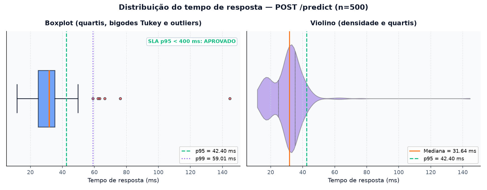
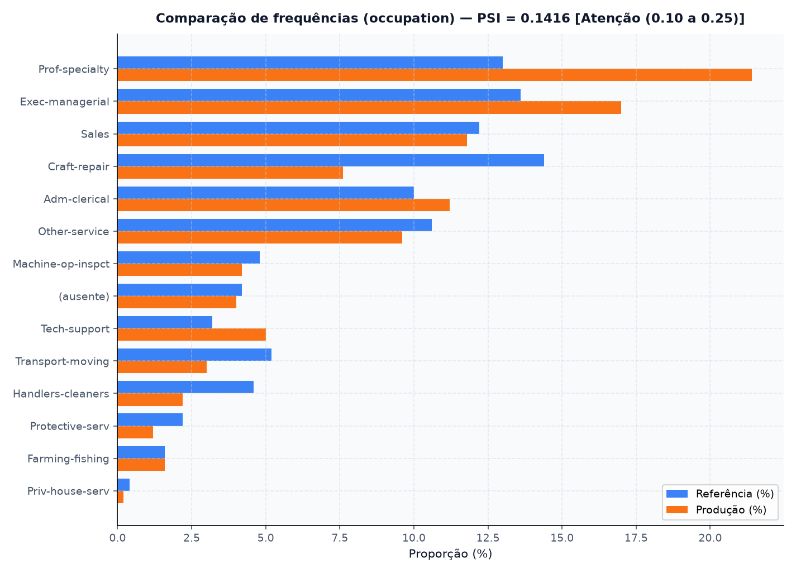
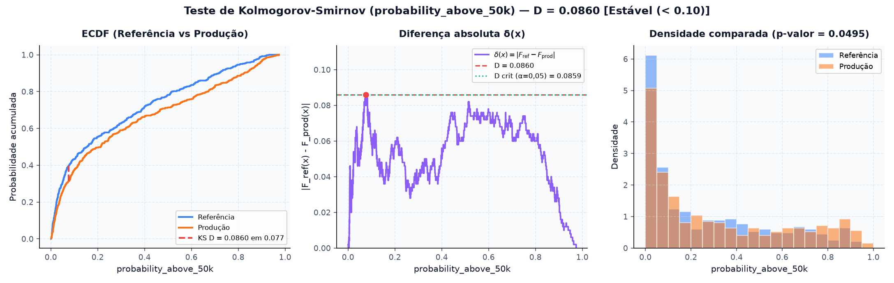

# AV2 (Parte 2) — Relatório de Monitoramento Estatístico e Drift

## 1. Resumo executivo

Este relatório apresenta a execução e os resultados da **Parte 2 da AV2** sobre o serviço `CareerPathService` (`POST /predict`), dando continuidade ao logging JSONL e métricas Prometheus da [Parte 1](../av2-p1/escopo.md). Todas as medições abaixo foram obtidas contra uma instância real do servidor BentoML `1.4.39` rodando localmente em Windows (Python `3.12.14`, modelo `adult-income-v1`), com evidências versionadas em [`docs/av2-p2/evidence/`](evidence/summary.json) para reprodução offline e visualização no dashboard Streamlit ([`scripts/dashboard.py`](../../scripts/dashboard.py)).

| Frente analisada | Amostra | Resultado principal | Diagnóstico |
| --- | --- | --- | --- |
| Latência HTTP (`POST /predict`) | 500 pedidos | `p50 = 31,64 ms` · `p90 = 40,10 ms` · `p95 = 42,40 ms` · `p99 = 59,01 ms` | SLA `p95 < 400 ms` **APROVADO** (folga de `357,60 ms`) |
| Drift de entrada (`occupation`) | 500 Ref vs 500 Prod | **PSI = `0,1416`** (`14` categorias, `null` como `"(ausente)"`) | **Atenção (`0,10` a `0,25`)** — mudança moderada coerente com a campanha simulada |
| Drift de saída (`probability_above_50k`) | 500 Ref vs 500 Prod | **KS `D = 0,0860`** (`p-valor = 0,0495`) · Δ mediana `+0,0585` | Magnitude **Estável (`< 0,10`)**, porém estatisticamente detectável a 5% |

## 2. Análise do tempo de resposta (`POST /predict`)

### 2.1 Coleta e estatísticas não paramétricas

Foram enviados **500 pedidos válidos consecutivos** (`scripts/part2_collect.py`) ao endpoint `POST /predict`, alternando perfis de Referência e Produção e registrando o tempo total de resposta HTTP no cliente (`perf_counter()`). Também foram cruzados os **1.500 eventos** completos gravados pelo middleware ASGI em `logs/inference.jsonl` (500 de benchmark + 500 de Referência + 500 de Produção).

| Estatística (ms) | Cliente HTTP (`n=500`) | Log interno ASGI (`n=1500`) |
| --- | ---: | ---: |
| Mínimo | `11,64` | `7,74` |
| Q1 (25%) | `24,87` | `11,75` |
| Mediana (p50) | `31,64` | `14,00` |
| Q3 (75%) | `35,28` | `15,24` |
| IQR (`Q3 - Q1`) | `10,40` | `3,49` |
| Bigode inferior (Tukey) | `11,64` | `7,74` |
| Bigode superior (Tukey) | `49,68` | `20,16` |
| **p90** | **`40,10`** | `16,41` |
| **p95** | **`42,40`** | `17,38` |
| **p99** | **`59,01`** | `27,65` |
| Máximo | `144,56` | `135,50` |
| Outliers além de `1,5 × IQR` | `6` (`58,98` a `144,56`) | `22` (`21,43` a `135,50`) |
| SLA (`p95 < 400 ms`) | **APROVADO** | **APROVADO** |

### 2.2 Explicação dos resultados, boxplot e gráfico de violino

1. **Conformidade com SLA e estatísticas não paramétricas:** latências de API são tipicamente assimétricas à direita (com picos ocasionais), tornando a média sensível a extremos. Pelos percentis observados no cliente, **90%** das respostas ficaram abaixo de **`40,10 ms`**, **95%** abaixo de **`42,40 ms`** (quase **10× abaixo** do teto de SLA de `400 ms`) e **99%** abaixo de **`59,01 ms`**.
2. **Leitura do Boxplot:** sintetiza o resumo dos cinco números (`mínimo/bigode inferior`, `Q1`, `mediana`, `Q3`, `máximo/bigode superior`). Metade central das requisições concentra-se entre `24,87 ms` (`Q1`) e `35,28 ms` (`Q3`), com `IQR = 10,40 ms`. Dentro da caixa há leve assimetria para valores menores (`Q2 - Q1 = 6,77 ms` > `Q3 - Q2 = 3,64 ms`), enquanto os bigodes de Tukey vão de `11,64 ms` a `49,68 ms`, isolando apenas **6 outliers** à direita (`1,2%` dos pedidos, máximo `144,56 ms`, atribuível a aquecimento inicial/GC do worker Python no loopback Windows).
3. **Leitura do Gráfico de Violino:** enquanto boxplots distintos podem coincidir quando compartilham os mesmos quartis, o violino combina a caixa estatística com a estimativa de densidade por kernel (KDE) espelhada, revelando a **densidade bimodal assimétrica** da série — há um ombro secundário próximo a `17–20 ms` (respostas rápidas com cache/conexão aquecida), uma concentração principal bem pronunciada ao redor da mediana (`31,64 ms`) e uma cauda longa e fina à direita até `144,56 ms`.
4. **Diferença entre cliente HTTP e log interno ASGI:** a mediana interna do servidor foi `14,00 ms` (`p95 = 17,38 ms`), enquanto a ponta do cliente mediu `31,64 ms` (`p95 = 42,40 ms`). A diferença (~`17–25 ms`) corresponde ao custo de serialização JSON, stack TCP loopback e leitura HTTP em chamadas sequenciais pela biblioteca padrão `urllib` (sem reaproveitamento de conexão keep-alive).

## 3. Conjuntos de Referência e Produção (500 inputs válidos cada)

- **Conjunto de Referência (`reference-inputs.jsonl`, `n=500`):** amostra determinística (`seed=42`) da partição de treino oficial do UCI Census Income / Adult (`data/raw/adult.data`, após limpeza e remoção das 25 linhas exatamente sobrepostas ao teste via `remove_test_overlap`). Todos os 500 registros foram validados contra [`Profile`](../../src/careerpath/schema.py) e obtiveram HTTP `200`.
- **Conjunto de Produção (`production-inputs.jsonl`, `n=500`):** simulação realista (`seed=42`) a partir da partição `adult.test` representando expansão do produto para perfis técnicos/gerenciais (reponderação de `Prof-specialty` ×2,1, `Exec-managerial` ×2,0, `Tech-support` ×2,2, `Sales` ×1,4 e redução proporcional de ocupações manuais/agrícolas), acompanhada de deslocamento positivo moderado em `age` (`+1` a `+6` anos, limitado a `17..100`) e `hours_per_week` (`+2` a `+7` h, limitado a `1..99`). Todos os 500 registros passaram na validação de `Profile` e retornaram HTTP `200`.

## 4. Monitoramento de drift: seleção de variáveis, PSI e KS

Seguindo o critério da atividade, consideram-se contínuas para **KS** apenas variáveis reais, reais não negativas ou inteiras com range maior que 100. No contrato [`Profile`](../../src/careerpath/schema.py), `age` (`17..100`, range `83`) e `hours_per_week` (`1..99`, range `98`) têm range `<= 100`; portanto:

- **Variável de entrada monitorada:** `occupation` (categórica com 14 opções + `null` explícito mapeado para `"(ausente)"`) → **Population Stability Index (PSI)** com suavização `epsilon = 1e-6`.
- **Variável de saída monitorada:** `probability_above_50k` (contínua real no intervalo `[0, 1]`) → **Distância de Kolmogorov-Smirnov (KS)**.

### 4.1 Resultado da entrada (`occupation` — PSI)

O **PSI total observado foi `0,1416`** (`Atenção: 0,10 a 0,25`), indicando mudança moderada na mistura ocupacional sem ruptura severa de domínio. Matematicamente, o PSI equivale à **divergência de Kullback–Leibler simetrizada** (divergência de Jeffreys):

$$\mathrm{PSI} = D_{\mathrm{KL}}(P_{\mathrm{prod}} \parallel P_{\mathrm{ref}}) + D_{\mathrm{KL}}(P_{\mathrm{ref}} \parallel P_{\mathrm{prod}}) = \sum_{i} \left(p_{\mathrm{prod}, i} - p_{\mathrm{ref}, i}\right) \ln\!\left(\frac{p_{\mathrm{prod}, i}}{p_{\mathrm{ref}, i}}\right)$$

As categorias que mais contribuíram para o índice foram:

| Categoria | Ref (`%`) | Prod (`%`) | Diferença (`p.p.`) | Contribuição PSI |
| --- | ---: | ---: | ---: | ---: |
| `Craft-repair` | `14,40%` (`72`) | `7,60%` (`38`) | `-6,80` | `0,0435` |
| `Prof-specialty` | `13,00%` (`65`) | `21,40%` (`107`) | `+8,40` | `0,0419` |
| `Handlers-cleaners` | `4,60%` (`23`) | `2,20%` (`11`) | `-2,40` | `0,0177` |
| `Transport-moving` | `5,20%` (`26`) | `3,00%` (`15`) | `-2,20` | `0,0121` |
| `Tech-support` | `3,20%` (`16`) | `5,00%` (`25`) | `+1,80` | `0,0080` |
| `Exec-managerial` | `13,60%` (`68`) | `17,00%` (`85`) | `+3,40` | `0,0076` |
| `(ausente)` (`null`) | `4,20%` (`21`) | `4,00%` (`20`) | `-0,20` | `0,0001` |

### 4.2 Resultado da saída (`probability_above_50k` — KS)

O teste **KS biamostral** ($D_{n,m} = \sup_x |F_{\mathrm{ref},n}(x) - F_{\mathrm{prod},m}(x)|$) registrou distância máxima **`D = 0,0860`** (no ponto `probability_above_50k = 0,0769`, onde a ECDF da Referência atingiu `0,400` e a de Produção `0,314`), com **`p-valor = 0,0495`**. O painel central da figura acima exibe a curva completa $\delta(x) = |F_{\mathrm{ref}}(x) - F_{\mathrm{prod}}(x)|$ e compara $D$ tanto com a estatística observada quanto com o limiar crítico teórico $D_{\mathrm{crit}}(\alpha) = c(\alpha)\sqrt{\frac{n+m}{n\cdot m}}$.

- **Interpretação prática vs estatística:** para `n = m = 500` e $\alpha = 0{,}05$ ($c(0{,}05) \approx 1{,}358$), o valor crítico resulta em **$D_{\mathrm{crit}}(0{,}05) = 0{,}0859$** — portanto $D = 0{,}0860$ ultrapassa marginalmente o corte estatístico (explicando `p-valor = 0,0495`), ao mesmo tempo em que permanece abaixo do limiar operacional de alerta `D >= 0,10` (classificação **Estável (`< 0,10`)**). A média das probabilidades subiu de `0,2656` para `0,3174`, a mediana de `0,1542` para `0,2128` (`+0,0585`) e o `p95` de `0,8093` para `0,8834`, refletindo a maior presença de perfis técnicos/gerenciais e maior jornada semanal em Produção.

### 4.3 Visão complementar de todas as variáveis do contrato

| Variável | Papel | Tipo / Range | Métrica | Valor | Diagnóstico |
| --- | --- | --- | --- | ---: | --- |
| **`occupation`** | **Entrada (principal)** | Categórica | **PSI** | **`0,1416`** | **Atenção (`0,10` a `0,25`)** |
| **`probability_above_50k`** | **Saída (principal)** | Contínua `[0, 1]` | **KS** | **`0,0860`** (`p=0,0495`) | **Estável (`< 0,10`)** |
| `age` | Entrada (apoio) | Inteiro (range `83 <= 100`) | PSI (10 faixas) | `0,1529` | Atenção (`0,10` a `0,25`) |
| `hours_per_week` | Entrada (apoio) | Inteiro (range `98 <= 100`) | PSI (10 faixas) | `1,7635` | Alerta (`>= 0,25`) |
| `education` | Entrada (apoio) | Categórica | PSI | `0,0779` | Estável (`< 0,10`) |
| `workclass` | Entrada (apoio) | Categórica | PSI | `0,0311` | Estável (`< 0,10`) |
| `marital_status` | Entrada (apoio) | Categórica | PSI | `0,0151` | Estável (`< 0,10`) |
| `income_class_proxy` | Saída (apoio) | Categórica | PSI | `0,0246` | Estável (`< 0,10`) |

> Nota de negócio: conforme [`Entendimento de negócio`](../../Entendimento%20de%20neg%C3%B3cio.docx.pdf), `hours_per_week` apresentou PSI alto (`1,7635`) devido ao deslocamento intencional de `+2` a `+7` horas em faixas estreitas de 40h no treino; mesmo com essa mudança e o deslocamento de `occupation`, a proporção de classe predita (`income_class_proxy`, PSI `0,0246`) variou suavemente porque a regressão logística combina todas as 6 variáveis. Drift de entrada ou saída não comprova isoladamente perda de acurácia, mas justifica auditoria periódica dos rótulos reais.

## 5. Referências bibliográficas

1. **Gallindo, L. (`lgallindo/bentoML-processamento-imagens`).** Serviço BentoML de referência e painéis Streamlit de monitoramento de drift por KS e PSI: [`service.py`](https://github.com/lgallindo/bentoML-processamento-imagens/blob/main/service.py), [`003_ks_drift_alert_streamlit`](https://github.com/lgallindo/bentoML-processamento-imagens/tree/main/003_ks_drift_alert_streamlit) ([app](https://ks-drift-alert.streamlit.app/)) e [`008_psi_drift_alert_streamlit`](https://github.com/lgallindo/bentoML-processamento-imagens/tree/main/008_psi_drift_alert_streamlit) ([app](https://psi-drift-alert.streamlit.app/)).
2. **Wikipedia — Teste Kolmogorov-Smirnov (biamostral):** definição de $D_{n,m} = \sup_x |F_{1,n}(x) - F_{2,m}(x)|$ e critério crítico $c(\alpha)\sqrt{(n+m)/(nm)}$. [pt.wikipedia.org/wiki/Teste_Kolmogorov-Smirnov](https://pt.wikipedia.org/wiki/Teste_Kolmogorov-Smirnov#Teste_Kolmogorov-Smirnov_biamostral).
3. **Wikipedia — Kullback–Leibler divergence (Symmetrised / Jeffreys divergence):** fundamentação matemática da divergência simetrizada subjacente ao PSI. [en.wikipedia.org/wiki/Kullback%E2%80%93Leibler_divergence](https://en.wikipedia.org/wiki/Kullback%E2%80%93Leibler_divergence#Symmetrised_divergence).
4. **Trybe Blog — Estatística: Boxplot:** anatomia do diagrama de caixa, resumo dos cinco números, assimetria e leitura de outliers. [blog.betrybe.com/estatistica/boxplot](https://blog.betrybe.com/estatistica/boxplot/).
5. **Leonardo (Medium) — Entendendo o Violin Plot:** combinação entre boxplot e estimativa de densidade por kernel (KDE) para identificar multimodalidade e concentração. [medium.com/@leonardo.leotc/entendendo-o-violin-plot-d6a5c4cc9bcc](https://medium.com/@leonardo.leotc/entendendo-o-violin-plot-d6a5c4cc9bcc).
6. **Massey, F. J. (1951).** *The Kolmogorov-Smirnov Test for Goodness of Fit*. Journal of the American Statistical Association, 46(253), 68–78.
7. **Siddiqi, N. (2006 / 2017).** *Credit Risk Scorecards: Developing and Implementing Intelligent Credit Scoring* (limiares clássicos do PSI `< 0,10`, `0,10–0,25`, `>= 0,25`). Wiley.
8. **Tukey, J. W. (1977).** *Exploratory Data Analysis* (quartis, IQR e regra de `1,5 × IQR`). Addison-Wesley.
9. **Hintze, J. L., & Nelson, R. D. (1998).** *Violin Plots: A Box Plot-Density Trace Synergism*. The American Statistician, 52(2), 181–184.
10. **Beyer, B., Jones, C., Petoff, J., & Murphy, N. R. (2016).** *Site Reliability Engineering* (SLAs baseados em percentis p90/p95/p99 de latência). O'Reilly Media.
11. **Dua, D. & Graff, C. (2017) / Becker, B. & Kohavi, R. (1996).** *Census Income (Adult) Dataset*. UCI Machine Learning Repository, ID 20, DOI `10.24432/C5GP7S`.
